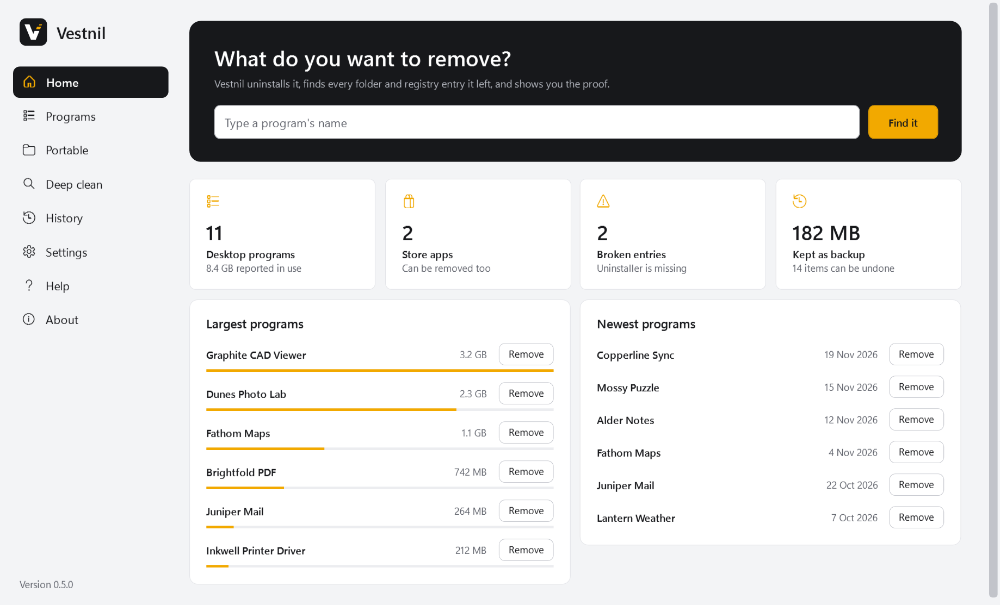
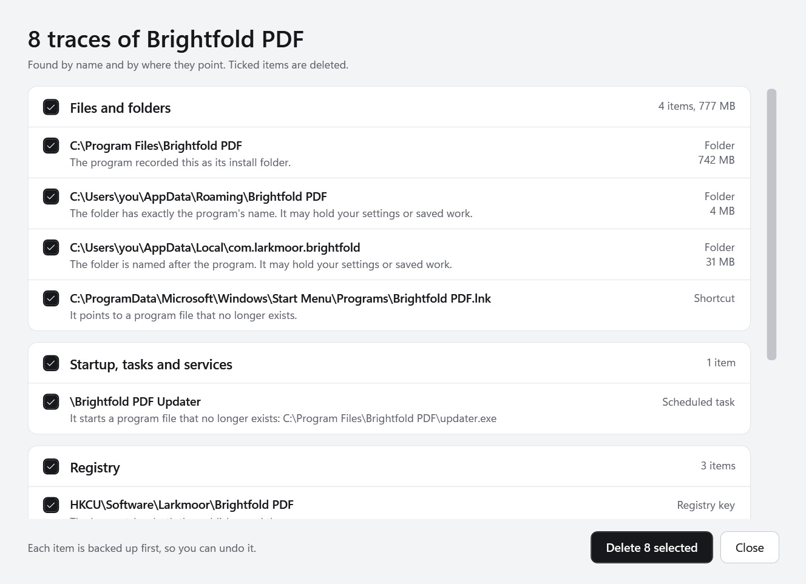
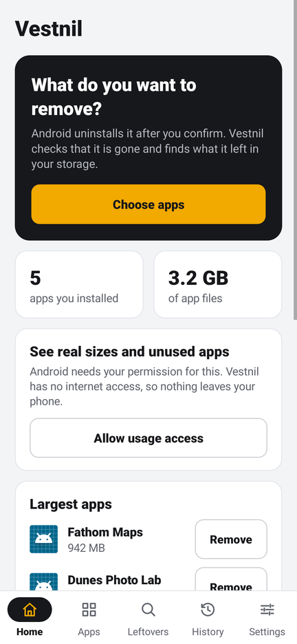

# Vestnil: free uninstaller for Windows 10 and 11

**Uninstall with proof.** Vestnil removes a program completely: it runs the uninstaller, then deletes leftover files, folders, settings and registry entries, checks again and shows you what is left. Free, no ads, no account, with undo. Made in India with love from Odisha.

**Website:** https://vestnil.netlify.app &nbsp;|&nbsp; [Español](https://vestnil.netlify.app/es) &nbsp;|&nbsp; [Português](https://vestnil.netlify.app/pt-br) &nbsp;|&nbsp; [Français](https://vestnil.netlify.app/fr) &nbsp;|&nbsp; [Deutsch](https://vestnil.netlify.app/de) &nbsp;|&nbsp; [Bahasa Indonesia](https://vestnil.netlify.app/id) &nbsp;|&nbsp; [हिन्दी](https://vestnil.netlify.app/hi)

## Download the latest version (0.5.1)

| For | Download |
|---|---|
| **Most people** | [**VestnilSetup.exe**](https://github.com/SMRUTIRANJAN30/vestnil/releases/latest/download/VestnilSetup.exe) (installer, also updates older versions) |
| **No installation** | [**Vestnil-portable.zip**](https://github.com/SMRUTIRANJAN30/vestnil/releases/latest/download/Vestnil-portable.zip) (unpack the whole folder, then open Vestnil.exe) |
| **Android phone** (preview) | [**Vestnil-0.1.0.apk**](https://github.com/SMRUTIRANJAN30/vestnil/releases/download/android-v0.1.0/Vestnil-0.1.0.apk) ([about it](https://vestnil.netlify.app/phone)) |

Needs 64-bit Windows 10 or 11, in any country. The app is in English. Please read the [terms](TERMS.txt) first.

## All versions

From 0.4.0 on, every public version stays available.

| Version | Status | Installer | Portable | Notes |
|---|---|---|---|---|
| **0.5.1** | Latest, recommended | [VestnilSetup-0.5.1.exe](https://github.com/SMRUTIRANJAN30/vestnil/releases/download/v0.5.1/VestnilSetup-0.5.1.exe) | [ZIP](https://github.com/SMRUTIRANJAN30/vestnil/releases/download/v0.5.1/Vestnil-0.5.1-portable.zip) | [What changed](https://github.com/SMRUTIRANJAN30/vestnil/releases/tag/v0.5.1) |
| 0.5.0 | Has a problem with Store apps, please update | [VestnilSetup-0.5.0.exe](https://github.com/SMRUTIRANJAN30/vestnil/releases/download/v0.5.0/VestnilSetup-0.5.0.exe) | [ZIP](https://github.com/SMRUTIRANJAN30/vestnil/releases/download/v0.5.0/Vestnil-0.5.0-portable.zip) | [What changed](https://github.com/SMRUTIRANJAN30/vestnil/releases/tag/v0.5.0) |
| 0.4.0 | Older preview | [VestnilSetup-0.4.0.exe](https://github.com/SMRUTIRANJAN30/vestnil/releases/download/v0.4.0/VestnilSetup-0.4.0.exe) | - | [What changed](https://github.com/SMRUTIRANJAN30/vestnil/releases/tag/v0.4.0) |

[See all releases](https://github.com/SMRUTIRANJAN30/vestnil/releases). To hear about new ones, choose **Watch > Custom > Releases** at the top of this page.

## What it does

- Uninstalls desktop programs and Microsoft Store apps, one or several at once
- Deletes what they leave: folders, settings, shortcuts, tasks, services, firewall rules and registry entries, with the reason for each
- Scans again at the end and shows the proof, which you can save as a report
- Force removes programs whose uninstaller is missing or fails
- Deep clean: finds what is left of programs you removed earlier, by name
- Finds portable programs and Python scripts that Windows doesn't list, with their settings folders
- Backs up what it deletes itself. Undo a whole removal with one click, or free the space at once
- Light and dark theme
- Makes no internet connections of its own. No accounts, ads or tracking

## 0.5.1 compared with 0.5.0

| Test | 0.5.0 | 0.5.1 |
|---|---|---|
| 1,502 items of one made-up program deleted | 127 seconds | **5 seconds** |
| Store app removal that fails or hangs | Could stay stuck and refuse to close | **Always ends with an answer** |
| Longest time the window did not react | Not measured | **70 ms** |
| Scan of MATLAB (a very large program) | 7 to 13 seconds | **2.6 seconds** |
| Automatic tests passed | 69 | 84 |

Measured on one PC.

## 0.5.0 compared with 0.4.0

| Test | 0.4.0 | 0.5.0 |
|---|---|---|
| All traces deleted (3 made-up programs, 69 traces) | 11 of 69 (16%) | **69 of 69 (100%)** |
| Folders deleted | 7 of 15 (47%) | **15 of 15 (100%)** |
| Registry entries deleted | 4 of 54 (7%) | **54 of 54 (100%)** |
| Other programs' items left alone | 15 of 15 | 15 of 15 |
| Real leftovers of two removed programs on our PC, found | 0 of 24 | **23 of 24 (96%)** |

The made-up traces are in the places 0.5.0 was built to check, so your own results can differ.

## Guides

- [How to uninstall a program completely](https://vestnil.netlify.app/uninstall-programs-completely)
- [How to remove leftover registry entries safely](https://vestnil.netlify.app/remove-leftover-registry-entries)
- [A program will not uninstall: what to do](https://vestnil.netlify.app/program-will-not-uninstall)
- [Questions and answers](https://vestnil.netlify.app/faq)

## Known limits

The installer isn't digitally signed yet, so Windows may show a SmartScreen warning. Drivers and parts of Windows are never removed. A file that Windows itself keeps open goes after a restart, with Deep clean. Vestnil has been tested on few PCs, so keep a backup of important work. It can't undo what another program's uninstaller does.

## Check your download

Run `Get-FileHash .\VestnilSetup.exe` in PowerShell and compare it with `SHA256.txt` in the release. If it's different, don't run the file. Don't turn off your antivirus to install Vestnil.

## Phone version (Android preview)

**[Vestnil-0.1.0.apk](https://github.com/SMRUTIRANJAN30/vestnil/releases/download/android-v0.1.0/Vestnil-0.1.0.apk)** for Android 8 and newer, 52 KB. Removes several apps (Android asks you to confirm each one), checks that they are gone, and cleans folders they left in shared storage. It has no internet permission. [More about it](https://vestnil.netlify.app/phone)

It is a preview: it passes 49 automatic app tests on the code of Android 8 to 15, and it has not been tested on a real phone yet. Download it only from here or from the website.

## Report a problem

Your reports help us decide what to fix first. Email us what you did, what you expected and what happened, or use [the form on the website](https://vestnil.netlify.app/report). Ideas and complaints are welcome too.

## Contact

Smrutiranjan Sahoo, smrutiranjansahoopikun@gmail.com. Please report security problems by email, not in a public issue. See [SECURITY.md](SECURITY.md).

This repository hosts downloads only. Vestnil's source code is private. Copyright (c) 2026 Smrutiranjan Sahoo. All rights reserved.
